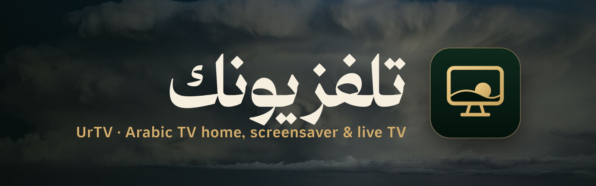
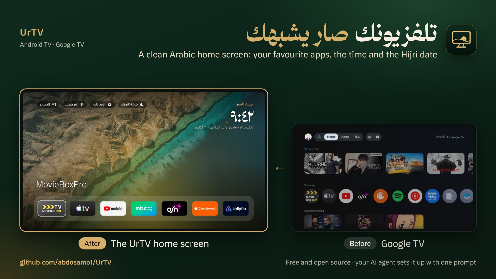
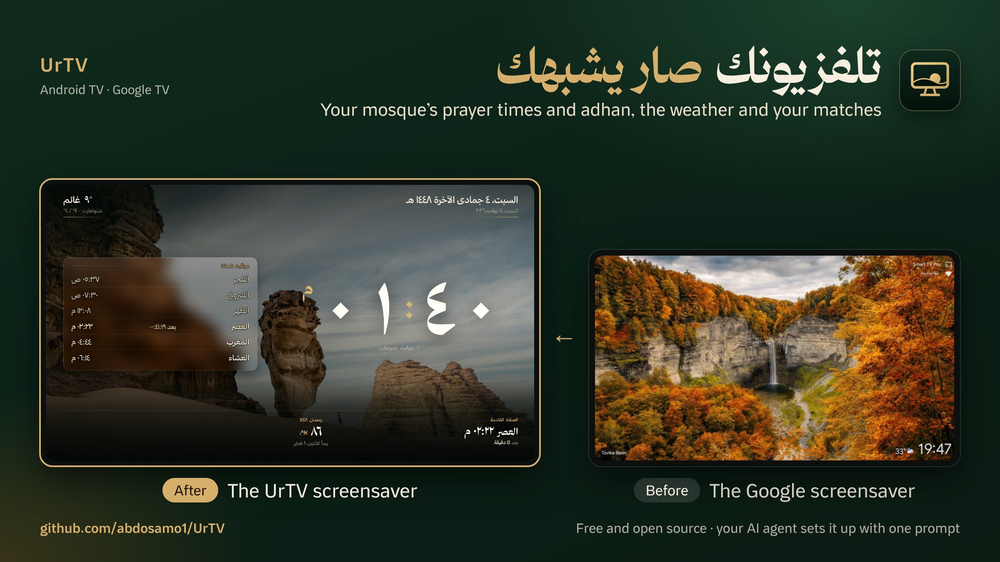
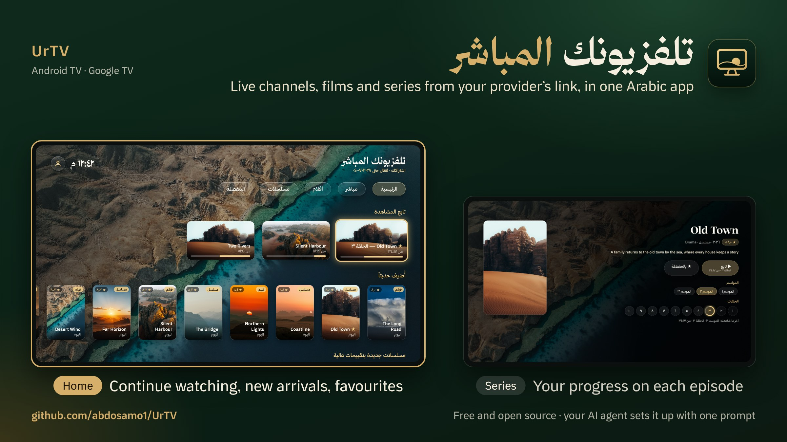

<p align="center"></p>

<h1 align="center">تلفزيونك · UrTV</h1>

<p align="center">A new Arabic home screen, a screensaver and a live TV app for Android TV / Google TV, made for Muslim families in Europe.<br>Prayer times and the adhan from your own mosque, a lighter, faster TV, and your AI agent sets it all up.</p>

<p align="center"></p>
<p align="center"></p>
<p align="center"></p>

> **Prayer times from your mosque.** Pick your mosque on [Mawaqit](https://mawaqit.net) by its link: the adhan,
> iqama and Friday times on the screen are the ones your mosque publishes. The city, weather and time zone follow
> where the TV is connected, named in the country's language («Stuttgart, Deutschland»). The adhan plays on the TV
> at each prayer, with a separate voice for Fajr and its own volume.

## Set it up in 3 steps

### ① The TV
Settings → About → press OK on **Build** 7 times. Then go to **Developer options** → turn on **USB debugging**.

### ② A computer on the same Wi-Fi, with one of these

| **Codex** (OpenAI) | **Claude Code** (Anthropic) |
|---|---|
| Free with a ChatGPT account | Needs Claude Pro ($20/month) |
| Download the Codex app | Download the Claude app → **Code** tab |
| Approvals: choose **«Approve for me»** | Approvals: **Allow** for the whole task |

<sub>Windows: install Git and Python first (`winget install Git.Git Python.Python.3.12`). Gemini CLI is free and reported to work; not tested by us.</sub>

### ③ Paste this

> Set up my TV with https://github.com/abdosamo1/UrTV: clone it and follow `docs/SETUP-PROMPT.md` step by step. You are on a computer on the same Wi-Fi as the TV.

#### What happens after pasting?
It asks your **name**, your **picture** (optional, shown beside the clock), your **city**, the link of your nearest mosque on **Mawaqit**, and your **clubs**. The TV asks **Allow** once, then leave it: 40 minutes, a few restarts.

#### Can I put it back as it was?
Yes, anytime: our apps are removed, what we turned off comes back on, the TV's own screen returns.
<sub>`optimize/reset.sh`</sub>

#### A new version came out?
Nothing to do: the apps update themselves from the internet every 6 hours, no laptop needed, and all your settings stay. «حدّث الآن» in the settings updates at once; تلفزيونك المباشر offers the update when you leave it.
<sub>`optimize/install.sh all`</sub>

#### The TV updated its system and locked our app out?
Redo the whole setup with one command, settings kept.
<sub>`optimize/run.sh again`</sub>

**Safe:** nothing is uninstalled; AirPlay, Chromecast and voice are never touched; a 5-minute safety switch puts the
stock home back if ours doesn't come up. The apps are built and signed by GitHub Actions from this repo (version
3.N = the build number). The full prompt: [docs/SETUP-PROMPT.md](docs/SETUP-PROMPT.md). To build a different
screen: [docs/RECREATE-PROMPT.md](docs/RECREATE-PROMPT.md).

## What you get

| | | |
|---|---|---|
| **شاشة تلفزيونك** · screensaver | Clock, Hijri date, prayer times and iqama, Ramadan, the adhan from your mosque, your teams' matches, weather, and beside the clock your choice of today's prayers, the 5-day forecast, all your teams' games, or a verse/hadith of the day, over landscape photos | `urtv-screensaver.apk` |
| **تلفزيونك المباشر** · live TV | Live channels, films and series from your provider's link (Xtream, M3U or MAG portal): continue watching, favourites (long OK), search per section, progress on each episode, several accounts | `urtv-live.apk` |
| **تلفزيونك** · home screen | Clean Arabic launcher: favourites row (5–10 apps) arranged in «ترتيب المفضلة», all apps, inputs, Wi-Fi, settings; optional card from the screensaver (off by default) | `urtv-home.apk` |
| **Two free apps** | [TV Bro](https://github.com/truefedex/tv-bro), a web browser for the TV, and [SmartTube](https://github.com/yuliskov/SmartTube), YouTube without ads, from their own releases (skip with `SKIP_EXTRAS=1`) | `optimize/install.sh extras` |
| **Speed-up** | Telemetry, ads and demos off (reversibly), closed apps frozen, Play Store kept from running in the background, faster animations | `optimize/` |

**Download the apps yourself:** [releases/apk-latest](https://github.com/abdosamo1/UrTV/releases/tag/apk-latest)
(install with `adb install`; the agent route above also sets everything up).
Every build is also kept as a numbered release (`v3.N`, the apps' version), to go back to one:
`APK_TAG=v3.N optimize/install.sh all`.

## For agents and scripts

Everything is scriptable over ADB, made for slow Wi-Fi (retries, resumable uploads, every step remembered):

| | |
|---|---|
| `optimize/find-tv.sh` | `--check`: can this terminal reach the home network at all (not from a cloud or sandbox) · then finds the TV (Windows, Mac, Linux) |
| `optimize/run.sh` | the whole setup; run again after any failure to continue · `status` · `again` after a TV system update (redo all, settings kept) |
| `optimize/saver.sh` | screensaver settings: `show`, `cities`, `city`, `find-team`, `teams`, `card`, `home-card`, `adhan`, `adhan-voice`, `adhan-fajr`, `adhan-volume`, `adhan-test`, `photos`, `idle`, `update` |
| `optimize/dock.sh` | favourites row: `show`, `apps`, `set`, `reset`; `hidden`, `hide PKG`, `show PKG` for apps left off the home screen; `webapp add URL` a website as an app (optional, first in the favourites) |
| `optimize/measure.sh` · `shot.sh` | memory before/after (restart + settle) · screenshots without navigating |
| `optimize/keep.sh` | turn back on anything protected (AirPlay, casting, voice, updates…) that something turned off |
| `docs/TVS.md` | what was seen on each TV model (ADB port, home switch, what to watch out for) |
| `optimize/reset.sh` | back to stock: lists re-enabled, stock home and screensaver back, our apps removed |
| `optimize/share.sh` | if the owner wants: how the setup went (TV model, time per step, what failed, memory before/after; nothing personal), sent anonymously to the author (from their phone by a QR code if this computer is offline) |

What we learned on real TCL sets, and what must stay on: [docs/OPTIMIZE.md](docs/OPTIMIZE.md). Manual test plan:
[docs/TEST-PLAN.md](docs/TEST-PLAN.md).

## For developers

```
src/template.html     the screen (HTML/CSS/JS, no framework); edit this, then run src/build.py
src/build.py          builds the two pages in dist/
dist/urtv.html        stand-alone page, fonts and photos inlined: open in any browser (F = full screen), works offline
dist/tv.html          light page the Android app loads (0.3 MB); the app serves fonts and photos from disk
android/app           the screensaver app (sa.urtv.screensaver): DreamService, settings, auto-update
android/launcher      the home screen (sa.urtv.home)
android/live          تلفزيونك المباشر (sa.urtv.live): the page in assets/live over Media3 players
assets/               fonts, bundled photos, Arabic team names, verse and hadith texts
photos/               the hosted photo set (5 shown per 4 days, rotating every 30 min)
optimize/             TV tools (Python ADB client, no adb binary needed); lists/ says what may be turned off
docs/                 the agent prompts (setup, recreate), what we learned on real TVs, test plan, photo credits
.github/              CI: APK builds, checks, data tools (verses, hadith, clubs, photos), README images
tests/run.sh          every check: build, data, fonts, scripts, private data, flaky-ADB upload, the screen in a browser
```

A push to `master` builds the three APKs in GitHub Actions and publishes them to `apk-latest` and a numbered `v3.N`
release; a push to `next` publishes `apk-next` instead (a test build). `tests/run.sh` runs on `master`, `next`,
`content` and pull requests. Local Android build (needs the SDK): `python3 src/build.py && gradle -p android assembleRelease`
(signed with the debug key; the release key lives only in the repository's secrets).

**Screen settings** come from the URL fragment (works on `file://` and in WebView):

```
urtv.html#city=Stuttgart&lat=48.7758&lon=9.1829&tz=Europe/Berlin&mosque=<mawaqit-slug>&teams=133604&panel=prayers
```

`teams`: up to 10 TheSportsDB ids in priority order. `panel`: the card beside the clock: `auto` (the four in turn every 30 s, the default), `prayers`,
`forecast`, `matches`, `verse` or `none`. `mosque`: a Mawaqit slug; `loc=auto`: the place from the connection.

**Data** (free, no keys): Mawaqit (your mosque's timetable), Aladhan (prayer times when no mosque is chosen), Open-Meteo (weather),
TheSportsDB (matches). Everything fails soft: offline, the clock, dates, prayer and Ramadan
countdowns still work and the last good data stays on screen. A finished game's score stays up for a day.

**Verse and hadith texts are never typed by hand:** verses come from the Quran API via CI
(`.github/tools/fetch_verses.py`); each hadith is checked by CI (`.github/tools/verify_hadith.py`) against the
Arabic text of the six Sunni books, and only those found are shown, with the books as the source line.

**The Android apps** update the screen page from this repo every 6 hours (so it must stay public), start fast
(the page shows once the clock, saved panels and photo are ready), and come back after a power cut.

## Credits

Photos: Unsplash photographers, listed in [docs/PHOTO-CREDITS.md](docs/PHOTO-CREDITS.md). Fonts: Thmanyah, and
Noto Naskh Arabic for ﷺ ﴿﴾ (OFL, `assets/fonts/`).
Home screen adapted from [mihirgupta0900/tv-home](https://github.com/mihirgupta0900/tv-home) (MIT,
`android/launcher/LICENSE-tv-home`). Package ratings from [UAD-ng](https://github.com/Universal-Debloater-Alliance/universal-android-debloater-next-generation).
